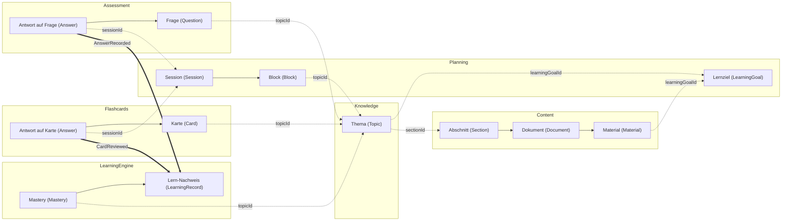

# Objektmodell

Jedes fachliche Objekt von Edvaniq gehört genau einem Service, seinem Owner. Nur der Owner legt es an, ändert und löscht es, und nur seine Datenbank enthält seinen Inhalt. Alle anderen Services kennen höchstens den Schlüssel des Objekts und bekommen den Rest als Ereignis oder fragen ihn beim Owner ab. Was die Begriffe bedeuten, steht im [Glossar](glossary.md), hier steht, wo sie wohnen. Die Datei beschreibt den Zielzustand des MVP, ein Objekt zieht also erst in seinen Service ein, wenn das Feature dazu gebaut wird. Datenbankschemata gehören nicht hierher, sie entstehen mit den Migrationen der Services.

Die Aufteilung folgt den [Service-Regeln](../architecture.md#service-regeln). Von Daten eines anderen Service speichert ein Service nur den Schlüssel und Werte, die er selbst daraus berechnet (Regel 5). Hört Service A auf Ereignisse von B, bekommt B Daten von A nur per HTTP-Abfrage (Regel 6). Welche Ereignisse es gibt, welche Felder sie tragen und wer sie empfängt, legt der [Ereigniskatalog](events.md) fest. Hier steht nur, welche Ereignisse der Owner eines Objekts sendet. Begriffe, die das Glossar noch nicht kennt, etwa die aktive Lernzeit oder die Einstellungen eines Kontos, kommen mit ihrem Feature ins Glossar und danach hierher.

## Services im MVP

| Service | Stand im MVP |
|---|---|
| Identity | produktiv |
| Planning | produktiv |
| Content | produktiv, mit Worker |
| Knowledge | produktiv |
| Assessment | produktiv |
| LearningEngine | produktiv |
| Flashcards | produktiv ab Meilenstein M4 |
| Gateway, Web | produktiv, ohne Fachobjekte |
| Analytics, Notifications | nur Skelett: Projekt und Contracts, aber kein Deployment, keine Datenbank, keine Nutzerdaten |
| Gamification, Tutor | MVP-Plus, noch nicht aktiv |

## Wie die Objekte zusammenhängen

Das Bild zeigt die Beziehungen vom Lernziel bis zum Lern-Nachweis, jedes Objekt in dem Kasten seines Owners. Ein durchgezogener Pfeil verbindet Objekte im selben Service und zeigt auf das Objekt, zu dem das andere gehört. Ein gestrichelter Pfeil ist ein Verweis über die Servicegrenze, mit dem Schlüssel an der Linie. Er zeigt auf das Objekt, das der Schlüssel meint. Eine dicke Linie ist ein Ereignis vom Sender zum Empfänger.

## Objekte je Service

Pro Service gibt es eine Tabelle. Die Spalte „Objekt“ nennt den Begriff mit Link ins Glossar und seinen Namen im Code. „Schlüssel“ ist die Kennung, über die andere Services das Objekt ansprechen, sie heißen nach dem Muster `<objekt>Id` wie `topicId` im Glossar. „Andere Services“ sagt, wer das Objekt braucht und auf welchem Weg: als Ereignis über den Broker, als Abfrage per HTTP oder als Verweis, bei dem der andere Service nur den Schlüssel speichert. Ein Verweis steht im Modell des anderen Service als einfacher Wert, nie als Typ aus dem Service des Owners. Der Client holt Daten aus mehreren Services über das Gateway und kommt in den Tabellen nicht einzeln vor.

### Identity

Identity besitzt den Nutzer und alles, was zum Konto gehört. Es sendet `UserDeleted`.

| Objekt | Schlüssel | Andere Services |
|---|---|---|
| [Nutzer](glossary.md#nutzer) (`User`) | `userId` | Jeder Service mit Nutzerdaten speichert die `userId` als Verweis. Sie kommt aus dem Token (`sub`), nie aus der Anfrage. Wird ein Nutzer gelöscht, entfernt jeder dieser Services seine Daten (Ereignis `UserDeleted`). |

### Planning

Planning besitzt, was Zeit und Ablauf betrifft: Lernziele, Plan und Sessions. Es sendet `SessionCompleted`. Die Zusammenstellung einer Session übernimmt im MVP Planning, aus Abfragen bei LearningEngine, Flashcards und Assessment. Ein Session Generator in LearningEngine kommt erst nach dem MVP.

| Objekt | Schlüssel | Andere Services |
|---|---|---|
| [Lernziel](glossary.md#lernziel) (`LearningGoal`) mit seiner [Art](glossary.md#art-des-lernziels) (`LearningGoalKind`) | `learningGoalId` | Content und Knowledge speichern die `learningGoalId` als Verweis. Content fragt bei Planning ab, ob das Lernziel dem Nutzer gehört und welche Angaben die Analyse braucht (Abfrage). |
| [Prüfung](glossary.md#prüfung) (`Exam`) mit [Prüfungstermin](glossary.md#prüfungstermin) (`ExamDate`) | `learningGoalId`, denn ein Lernziel hat höchstens eine Prüfung | Flashcards fragt den Prüfungstermin ab, weil kein Intervall einer Karte über ihn hinausreichen darf (Abfrage). |
| [Lernplan](glossary.md#lernplan) (`StudyPlan`) | `userId`, denn der Plan gilt für alle aktiven Lernziele | Kein anderer Service braucht ihn. Planning berechnet ihn aus Abfragen bei LearningEngine (Mastery und Themenzustand), Flashcards (fällige Karten je Thema) und Assessment (Stand des Fragenpools) und speichert von Themen nur die `topicId`. |
| [Tagesplan](glossary.md#tagesplan) (`DayPlan`) mit [Tagesziel](glossary.md#tagesziel) (`DailyGoal`) | `userId` und [Lerntag](glossary.md#lerntag) | Kein anderer Service braucht ihn. Das Tagesziel ergibt sich aus den Blöcken des Tages. |
| [Tagesbudget](glossary.md#tagesbudget) (`DailyBudget`) | `userId` | Kein anderer Service braucht es. |
| [Block](glossary.md#block) (`Block`) | `blockId` | Kein anderer Service braucht ihn. Ein Block nennt die Themen, um die es geht, als `topicId`. |
| [Session](glossary.md#session) (`Session`) | `sessionId` | Assessment, Flashcards und LearningEngine speichern die `sessionId` an Antworten und Lern-Nachweisen als Verweis. Endet die Session, sendet Planning `SessionCompleted`, auch bei einem Abbruch (Vorschlag), und LearningEngine erfährt daraus, welche Themen die Session eingeführt hat (Ereignis). |
| [Lerneinheit „Neues Thema“](glossary.md#lerneinheit-neues-thema) (`IntroductionUnit`) | `sessionId`, denn die Einheit ist ein Schritt der Session | Kein anderer Service braucht sie. Die Zusammenfassung kommt von Content, die Checkfragen kommen von Assessment, der Client setzt beides zusammen. |
| [Wiederholung](glossary.md#wiederholung) (`Review`) | `sessionId`, denn die Wiederholung ist ein Schritt der Session | Kein anderer Service braucht sie. Planning stellt sie beim Start aus Abfragen zusammen: fällige Karten bei Flashcards, zuletzt falsch beantwortete Fragen bei Assessment, Themen mit zerfallener Mastery bei LearningEngine. |

### Content

Content besitzt das Material und alles, was direkt aus seinem Text entsteht. Der Worker von Content analysiert die Dokumente und erzeugt im Hintergrund Fragen und Karten. Content sendet `DocumentAnalyzed`, `DocumentDeleted` und `ItemsGenerated`. Weil Planning, Knowledge und Assessment auf Content hören, fragt Content bei ihnen ab, statt auf sie zu hören: bei Planning das Lernziel, bei Knowledge die Themen und bei Assessment den Stand des Fragenpools.

| Objekt | Schlüssel | Andere Services |
|---|---|---|
| [Material](glossary.md#material) (`Material`) | `learningGoalId`, denn es hat keinen eigenen Schlüssel und ist die Menge der Dokumente eines Lernziels | Kein anderer Service sieht es als Ganzes. |
| [Dokument](glossary.md#dokument) (`Document`) | `documentId` | `DocumentAnalyzed` erreicht Knowledge, das daraus die Themen übernimmt, und Planning, das neu plant. `DocumentDeleted` erreicht Knowledge, Assessment und Flashcards, die ihre Ableitungen entfernen. Sie speichern dafür die `documentId` als Verweis. |
| [Abschnitt](glossary.md#abschnitt) (`Section`) | `sectionId` | Der Text eines Abschnitts verlässt Content nicht. Knowledge speichert die `sectionId` in der Zuordnung zu Themen, Assessment und Flashcards als Quelle ihrer Items (Verweis). Dokument und Seite zeigt der Client aus Content an. |
| [Zusammenfassung](glossary.md#zusammenfassung) (`Summary`) | `topicId` und Längenstufe | Kein anderer Service braucht sie. Content speichert nur die `topicId` und fragt bei Knowledge die Abschnitte des Themas ab, wenn es sie schreibt (Abfrage). |

### Knowledge

Knowledge besitzt die Gliederung des Materials. Es übernimmt sie aus `DocumentAnalyzed`, der Nutzer ändert sie nur hier, und jede Änderung meldet Knowledge mit `TopicsChanged`.

| Objekt | Schlüssel | Andere Services |
|---|---|---|
| [Thema](glossary.md#thema) (`Topic`) | `topicId` | Planning, Assessment, Flashcards und LearningEngine hören auf `TopicsChanged` und speichern die `topicId` als Verweis, nie Namen oder Reihenfolge. Den Namen zeigt der Client aus Knowledge an. Content speichert die `topicId` an seinen Zusammenfassungen und fragt bei Knowledge die Themen eines Lernziels und die Abschnitte eines Themas ab (Abfrage). Ein Thema gehört zu genau einem Lernziel, und seine `topicId` bleibt beim Umbenennen gleich. |
| [Unterthema](glossary.md#unterthema) (`Subtopic`) | `topicId` | Ein Unterthema hat wie jedes Thema eine `topicId`. Ebene und übergeordnetes Thema sind Daten von Knowledge, wer sie braucht, fragt sie ab und speichert sie nicht. |
| [Kernbegriff](glossary.md#kernbegriff) (`KeyTerm`) | keiner | Kein anderer Service braucht ihn. Content erkennt ihn in der Analyse und meldet ihn mit `DocumentAnalyzed`, Knowledge speichert ihn am Thema. |

### Assessment

Assessment besitzt die Fragen und alles, was beim Beantworten entsteht. Erzeugt werden die Fragen im Worker von Content. Assessment übernimmt sie aus `ItemsGenerated`, und ab da gehören sie Assessment. Es sendet `AnswerRecorded` und `ItemFlagged`.

| Objekt | Schlüssel | Andere Services |
|---|---|---|
| [Frage](glossary.md#frage) (`Question`), in der Rolle als [Checkfrage](glossary.md#checkfrage) (`CheckQuestion`) | `itemId` | Assessment speichert zu jeder Frage die `topicId` als Verweis, dazu `sectionId` und `documentId`, wenn die Frage aus Material entstand. Eine Checkfrage ist keine eigene Art, sondern eine Frage in der Lerneinheit „Neues Thema“. Meldet ein Nutzer eine Frage, pausiert Assessment sie und sendet `ItemFlagged`, und LearningEngine nimmt ihre Antworten aus der Mastery (Ereignis). |
| [Fragenpool](glossary.md#fragenpool) (`QuestionPool`) | `topicId`, je Nutzer | Content und Planning fragen ab, wie viele nutzbare Fragen ein Thema hat und ob sein Pool bereit ist (Abfrage). Content erzeugt bei knappem Pool Fragen nach. |
| [Quiz](glossary.md#quiz) (`Quiz`) mit [Modus](glossary.md#modus) (`Mode`) | keiner | Kein anderer Service braucht es. Der Kurztest der Einstufung ist ein Quiz im Modus `Placement`. Der Prüfungsmodus `MockExam` gehört zum MVP-Plus. |
| [Antwort](glossary.md#antwort) (`Answer`) auf eine Frage | `answerId` | Assessment speichert jede Antwort sofort und sendet `AnswerRecorded`. LearningEngine macht daraus einen Lern-Nachweis (Ereignis). |

### Flashcards

Flashcards besitzt die Karten und ihren Wiederholungsverlauf. Es übernimmt erzeugte Karten aus `ItemsGenerated`, und Nutzer legen Karten auch von Hand an. Es sendet `CardReviewed` und `ItemFlagged`.

| Objekt | Schlüssel | Andere Services |
|---|---|---|
| [Karte](glossary.md#karte) (`Card`) | `itemId` | Flashcards speichert zu jeder Karte die `topicId` als Verweis, dazu `sectionId` und `documentId`, wenn die Karte aus Material entstand. Planning fragt die fälligen Karten je Thema ab (Abfrage). Meldet ein Nutzer eine Karte, pausiert Flashcards sie und sendet `ItemFlagged`. |
| [Antwort](glossary.md#antwort) (`Answer`) auf eine Karte | `answerId` | Flashcards speichert die Bewertung sofort und sendet `CardReviewed`. LearningEngine macht daraus einen Lern-Nachweis (Ereignis). |

### LearningEngine

LearningEngine besitzt, was aus den Antworten über den Lernstand folgt. Es sendet im MVP kein Ereignis, Planning und Client fragen seine Werte ab. Es hört auf `AnswerRecorded`, `CardReviewed`, `ItemFlagged`, `SessionCompleted` und `TopicsChanged`.

| Objekt | Schlüssel | Andere Services |
|---|---|---|
| [Lern-Nachweis](glossary.md#lern-nachweis) (`LearningRecord`) | `answerId`, denn jede Antwort hinterlässt genau einen Nachweis | Kein anderer Service liest ihn. Er entsteht aus `AnswerRecorded` und `CardReviewed` und trägt dazu `userId`, `topicId`, `itemId` und `sessionId`. |
| [Mastery](glossary.md#mastery) (`Mastery`) | `userId` und `topicId` | Planning und Client fragen sie ab (Abfrage). Sie lässt sich aus den Lern-Nachweisen innerhalb ihrer Aufbewahrungsfrist neu berechnen. |
| [Themenzustand](glossary.md#themenzustand) (`TopicState`) | `userId` und `topicId` | Planning und Client fragen ihn ab und rechnen ihn nicht selbst (Abfrage). |
| [eingeführt](glossary.md#eingeführt) (`Introduced`) | `userId` und `topicId` | LearningEngine erfährt aus `SessionCompleted`, dass die Lerneinheit zu einem Thema abgeschlossen ist. Planning erkennt neue Themen am Themenzustand (Abfrage). |
| [Einstufung](glossary.md#einstufung) (`Placement`) | `userId` und `topicId` | LearningEngine speichert die Selbsteinschätzung je Thema und leitet daraus den Startwert der Mastery ab. Der Kurztest läuft als Quiz bei Assessment, seine Antworten erreichen LearningEngine als Lern-Nachweise mit der Quelle Einstufung. |

## Begriffe ohne eigenen Owner

[Item](glossary.md#item) (`Item`) und [Antwort](glossary.md#antwort) (`Answer`) sind Oberbegriffe. Ein einzelnes Item ist immer eine Frage oder eine Karte und gehört damit genau einem Service, Assessment oder Flashcards. Eine Antwort gehört dem Service, dem ihr Item gehört. Die `itemId` ist über Fragen und Karten hinweg eindeutig, damit LearningEngine ein Item an der Kennung allein erkennt. Aus demselben Grund ist auch die `answerId` über Fragen und Karten hinweg eindeutig. Content vergibt sie, wenn es ein Item erzeugt, damit eine doppelte Zustellung von `ItemsGenerated` kein zweites Item anlegt, und der übernehmende Service behält sie. Karten, die ein Nutzer selbst anlegt, bekommen ihre `itemId` in Flashcards.

[Lerntag](glossary.md#lerntag) (`StudyDay`) ist eine Rechenregel und kein Objekt. Jeder Service speichert Zeitpunkte in UTC und bestimmt den Lerntag selbst mit der Tagesgrenze aus dem Glossar, zwischen Services wird er nie übertragen.

## Entscheidungen

### Erzeugen heißt nicht besitzen

Der Worker von Content erzeugt Fragen und Karten, besitzen werden sie Assessment und Flashcards. Content hält nach `ItemsGenerated` keine Kopie, sonst hätte jedes Item zwei Owner. Wie viele Fragen ein Pool noch hat, fragt Content bei Assessment ab, wenn es nachgenerieren will.

### Die Session gehört zu Planning

Planning besitzt den Block, der eine Session startet, und hakt ihn mit deren Abschluss ab. Außerdem hört LearningEngine auf Planning, und Planning holt die Mastery per Abfrage bei LearningEngine. Gehörte die Session LearningEngine, müsste Planning auf LearningEngine hören, und die Ereignisse bildeten einen Kreis. Das verbietet Regel 6.

### Die Zuordnung von Abschnitten zu Themen gehört zu Knowledge

Die Analyse in Content schlägt vor, welcher Abschnitt zu welchem Thema gehört. Der Nutzer ändert die Themen aber danach, er benennt sie um, blendet sie aus und fügt neue hinzu. Die Zuordnung ändert sich mit, deshalb liegt sie bei den Themen in Knowledge und nicht bei den Abschnitten in Content. Knowledge speichert dabei nur die `sectionId`. Content kann Knowledge nicht per Ereignis folgen, weil Knowledge auf Content hört, und fragt deshalb die Abschnitte eines Themas ab, wenn es eine Zusammenfassung oder Items erzeugt.

### Antwort und Lern-Nachweis sind zwei Objekte

Die Antwort mit den gewählten Optionen und dem Bezug zur Frage bleibt bei Assessment oder Flashcards. Der Lern-Nachweis bei LearningEngine enthält dagegen keinen Fragetext, keine Optionen und keine Lösung. Er trägt nur Schlüssel und die Werte, die LearningEngine für die Mastery verrechnet oder mitspeichert, die Felder stehen im [Ereigniskatalog](events.md#lern-nachweis). Damit ist er kein Abbild der Antwort, wie Regel 5 es verbietet, sondern die Eingabe einer Berechnung, die nur LearningEngine macht.

### Eine Fehlerkarte ist eine neue Karte

Aus einer falsch beantworteten Frage kann der Nutzer eine Karte machen. Flashcards fragt dafür einmal bei Assessment nach Frage und Lösung und legt eine neue Karte an. Sie gehört ab dann Flashcards und gleicht sich nicht mehr mit der Frage ab. Eine Kopie entsteht also nur durch diese Aktion des Nutzers und wird ein eigenes Objekt statt eines Read-Models.

## Plus und Skelett

Gateway und Web besitzen keine Fachobjekte. Der Web-Host hält die Anmeldung des Browsers als technische Sitzung, die mit der `Session` des Glossars nichts zu tun hat. Analytics und Notifications sind im MVP nur Skelett, sie speichern keine Nutzerdaten und besitzen deshalb keine Objekte. Gamification und Tutor gehören zum MVP-Plus. Ihre Begriffe stehen noch nicht im Glossar, sie bekommen ihren Eintrag, wenn das jeweilige Paket beginnt.

| Objekt | Owner | Stand |
|---|---|---|
| XP, Level und Streak | Gamification | MVP-Plus, Gamification hört dafür auf `SessionCompleted` und die Antwort-Ereignisse |
| Chatverlauf je Thema | Tutor | MVP-Plus |
| Prüfungsmodus (`MockExam`) | Assessment, am Quiz | MVP-Plus |

## Verweise

Jede Zeile dieser Tabelle ist ein Verweis nach Regel 5: Der speichernde Service hält den Schlüssel und rechnet damit, aber nicht den Inhalt dahinter. Namen von Themen, Texte von Abschnitten, Fragetexte und Lösungen bleiben bei ihrem Owner, und der Client holt sie über das Gateway.

| Schlüssel | Gehört zu | Steht als Verweis in |
|---|---|---|
| `userId` | Identity | jedem Service mit Nutzerdaten |
| `learningGoalId` | Planning | Content und Knowledge, dazu jedem Service, der Daten je Lernziel braucht, etwa Flashcards für den Prüfungstermin |
| `documentId` | Content | Knowledge, Assessment, Flashcards |
| `sectionId` | Content | Knowledge, Assessment, Flashcards |
| `topicId` | Knowledge | Planning, Content, Assessment, Flashcards, LearningEngine |
| `itemId` | Assessment bei Fragen, Flashcards bei Karten | LearningEngine |
| `answerId` | Assessment bei Fragen, Flashcards bei Karten | LearningEngine |
| `sessionId` | Planning | Assessment, Flashcards, LearningEngine |
